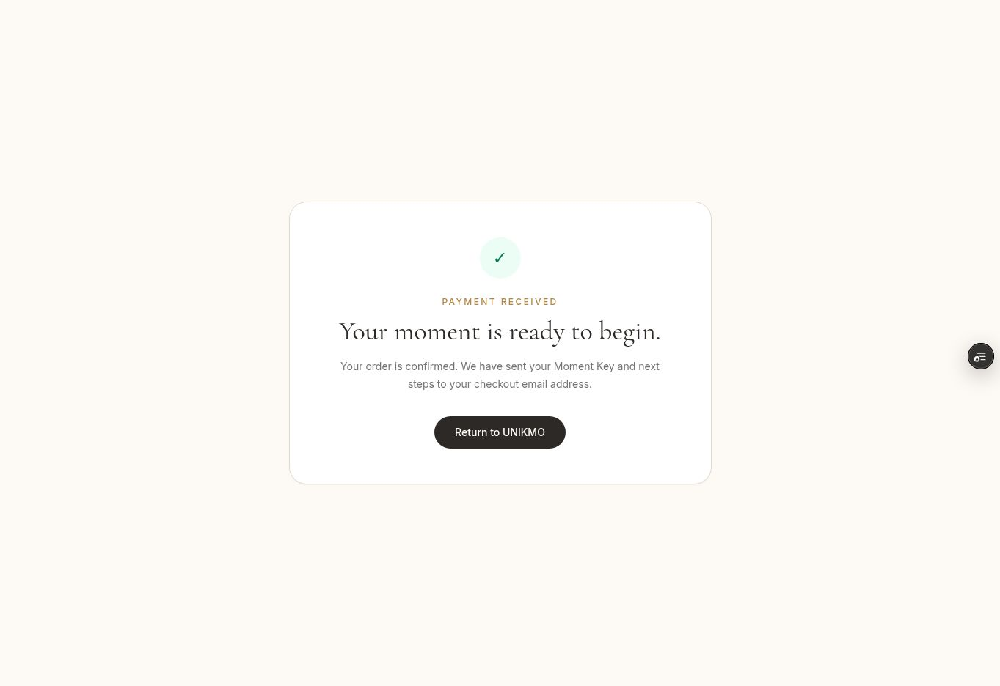

# Vercel Preview deployment audit — 2026-10-30

Scope: UNIKMO `madonna`, Preview only. No production deployment, merge, production credential change, or deletion of the existing Stripe webhook was performed.

Implementation commit: `0c75e65ce19f4766dc52886f731fc0babbba9d39`.
Verified deployment: https://madonna-ah5kiwgqa-unikmos-projects.vercel.app (Vercel Authentication remains enabled).

## Fixed deployment risks

- Replaced Next.js 14.2.35 with the patched 15.5.28 backport and updated its ESLint configuration. Updated Nodemailer to 10.3.1 and patched transitive dependencies, including an explicit PostCSS 8.5.32 override. The exact committed lockfile installs with zero npm audit findings.
- Removed bcrypt/jsonwebtoken from the Edge middleware import path. Middleware uses JOSE's direct JWT verification export and validates payload fields.
- Preview uses the `unikmo_preview` MongoDB database and a separately configured `PREVIEW_JWT_SECRET`. Production retains its previous database selection and `JWT_SECRET`.
- Preview refuses live Stripe API keys. The Preview signing-secret override is selected consistently, trimmed, and reflected in the admin payment status check.
- Payment confirmation now retrieves the Checkout Session from Stripe and only acknowledges a verified paid session. It resumes the same idempotent fulfillment path when webhook processing is delayed.
- Concurrent retries no longer acknowledge success while an email lease is still active. A retryable error keeps fulfillment recoverable.
- Preview fulfillment emails link to the Preview deployment, not the production site.
- Reduced the Server Actions request allowance from 1 GB to 1 MB; large media remains on the existing browser-to-S3 presigned upload path. Added explicit 60-second payment handler budgets.
- Removed raw signature-error objects from logs and rejected inherited object keys in the product lookup.
- Fixed Next.js 15 client route parameter compatibility and internal navigation errors exposed by the upgraded build checks.

## Verification evidence

| Check | Result |
| --- | --- |
| Clean install from committed lockfile | PASS |
| Full optimized Next.js build and type checks | PASS; existing non-blocking hook/image warnings remain |
| npm audit, production and development dependencies | PASS; zero reported vulnerabilities |
| Cross-environment administrator tokens | PASS; Preview and production tokens reject each other |
| Preview live-key guard and invalid product keys | PASS |
| Deployed payment confirmation without a valid session | PASS; does not claim payment received |
| Real Stripe sandbox payment | PASS; paid Checkout Session verified through Stripe |
| Deployed confirmation recovery | PASS; HTTP 200 and confirmed order rendered |
| Database result | PASS; one paid order, one code, email marked sent in `unikmo_preview` |
| Real test email receipt | PASS; connected recipient mailbox contains one matching order email with Preview links |
| Signed webhook-handler replay against the isolated Preview database | PASS; three concurrent simulated deliveries returned 200 and retained the same single order/code |
| Invalid webhook signature | PASS; HTTP 400 |
| Active email lease | PASS; HTTP 500 requests a retry; no extra code issued |
| Deployed admin authentication | PASS; wrong password 401, login 200, authorized orders 200, logout 200, access after logout 401 |
| Unauthenticated admin orders/payment status | PASS; HTTP 401 |

The webhook replay test calls the actual route handler with SDK-generated test signatures and the genuine paid test event. It is a simulation, not a Stripe Dashboard resend. A previous genuine Stripe resend was accepted with HTTP 200 after the signing-secret correction. The newer event's automatic delivery still reports pending; a genuine delivery to this final deployment has not yet been independently confirmed.

## Release hold and remaining limits

- Keep production on hold. Confirm one genuine Stripe delivery to the final Preview before any production release. The connected Stripe API does not expose the Dashboard resend action.
- MongoDB and AWS service credentials are still shared between environments. The Preview database namespace and authentication tokens are separated; this is not database-user/IAM isolation. Use separately scoped Preview service credentials before exposing Preview execution to untrusted code.
- Full storefront, hotel/cruise, media upload, accessibility, and all product/delivery combinations were outside this focused payment/deployment pass.
- The preview database starts without production data. No production admin accounts were copied; the temporary administrator used for authentication verification was removed.
